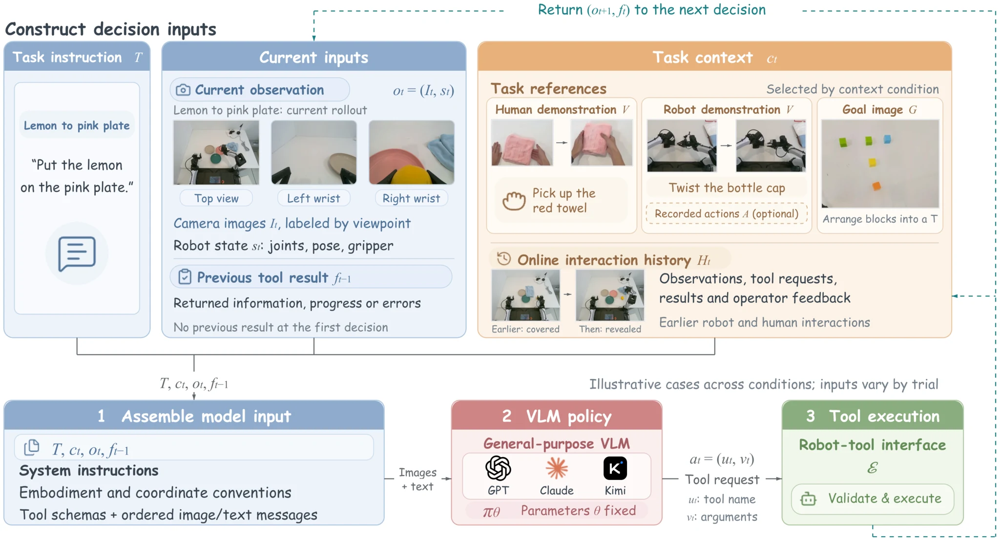

# In-Context Robot Learning with VLM Agents

- **首次提交**：2026-09-16
- **arXiv 主分类**：cs.CV
- **核验日期**：2026-11-11
- **整理来源**：保留 2026-09-23 周报条目及 v1 精读；本轮按用户提供的 GPT-Policy 项目入口增补官方后续结果与开放状态
- **名称说明**：GPT-Policy 是系统简称；arXiv 正式题名为 In-Context Robot Learning with VLM Agents
- **全文**：[HTML](https://arxiv.org/html/2609.19138)
- **作者**：Dongzhou Cheng, Taoran Yi, Ye Fang, Xingwu Zhang, Fan Feng, Yixuan Li, Gengxiong Zhuang, Rongze Wang, Shuai Yang, Wei Song, Weizhi Xue, Minyan Wu, Jie Gui, Jiaqi Wang, Tong Wu
- **年份与发表**：2026，arXiv，2026-09-16
- **arXiv ID**：2609.19138
- **DOI**：10.48550/arXiv.2609.19138
- **论文**：[arXiv](https://arxiv.org/abs/2609.19138)
- **正式出版**：未核验到
- **项目**：[Project](https://cheng-haha.github.io/GPT-Policy/)
- **代码**：[GitHub](https://github.com/cheng-haha/GPT-Policy)
- **数据**：[RoboDojo 示范上下文](https://huggingface.co/datasets/SII-CDZ/gpt-policy-robodojo-contexts)
- **模型**：使用商业 VLM，未发布独立机器人基础模型权重
- **AlphaXiv**：[AlphaXiv](https://alphaxiv.org/abs/2609.19138)
- **类别标签**：Embodied In-Context Learning, VLM Agent, Human Video
- **证据等级**：已核验 arXiv v1 方法与实验、官网后续结果及官方代码/数据页；v1 与官网新增试验分开记录，未独立复现

- **代表图**：Figure 2 · 示范与在线历史进入固定 VLM，结构化工具返回执行结果和新观察

来源：[论文原图](https://arxiv.org/html/2609.19138v1/overview.png)；[全文与图注](https://arxiv.org/html/2609.19138)。

## 当前挑战

机器人示范通常用于离线训练，新任务需要重新训练，代价较高。冻结 VLM 即使理解画面，也未必能确定双臂命令、接触顺序和具体位移，因此需要将示范中的操作经验转成可用于当前决策的上下文。

## 研究动机

GPT-Policy 用示范和交互历史引导冻结 VLM，使同一模型能从新初态执行任务。上下文编译器保留关键视觉状态变化及可用动作参考，工具层执行结构化动作并返回结果，形成无需参数更新的适应闭环。

人类视频无需机器人动作标签即可提供操作示例；对接触敏感的任务，带时间对齐动作参考的机器人示范更有效。

## 技术方案

**输入**：当前视觉观测、机器人状态、任务指令，以及人类或机器人示范、可选动作参考、目标图、执行历史和在线人类反馈。

**过程**：上下文编译器整理示范中的关键视觉变化及动作参考；固定 VLM 根据任务参考、当前观测和历史提出工具调用；受约束控制器完成空间定位、IK、轨迹限幅与实测执行检查，再将新观测和结果送回下一轮决策。

**输出**：工具化机器人动作，以及随交互与尝试更新的任务上下文。

### 方法细节与实现

**上下文组织。**任务指令、带视角标识的当前图像、机器人状态、目标图或示范关键帧、可选动作参考和本轮历史分开组织。示范按时间顺序交错图像与状态/动作文本，在线历史另存工具请求和执行结果；旧实时图像可以截断，任务参考则保留，避免混淆示范动作与当前已执行动作。

**控制链条。**VLM 结构化调用 move_to、move_eef_chunk 或夹爪命令。笛卡尔目标采用各手臂基座坐标系和 xyzw 四元数；控制器对位置做线性插值、对旋转做球面线性插值（SLERP），再以前一解为初值逐点求逆运动学（IK）。Ruckig 分配时间，满足采样轨迹的速度、加速度和加加速度（jerk）限制，执行后回传实测状态、端点误差及稳定情况。

**反馈与适应。**VLM 参数始终固定，行为变化来自示范、历史结果和人工反馈。被拒绝的请求也为下一轮提供信息；模型宣称完成与物理任务实际成功分别记录。运动学、标定和控制工具承担执行保障，VLM 的动作提议并非底层电机命令。

[方法与控制接口：原文第 3 节](https://arxiv.org/html/2609.19138#S3)。

## 实验结果

**arXiv v1。** 原文覆盖十个机器人任务，每条件仅 3 次试验。人类视频使部分任务从无示范的 0/3 提升至 2/3；接触敏感任务加入视频与动作参考后可达 3/3 或 2/3。表 1 同时报告成功数、决策次数和耗时：拾取笔记本从 0/3 升至 2/3，平均时间由 24.6 降至 16.1 分钟；拔插插头从仅视频的 0/3 升至视频加动作的 2/3，平均时间却由 7.9 增至 10.8 分钟。上下文可改善操作，但成功率提高不保证执行更快，小样本也不足以证明大规模泛化。

判断动作数值的独立作用，需要固定示范图像和非动作文本，并说明实测状态是否同时加入；否则增益也可能来自额外的程序描述或状态信息。商业模型版本、控制工具、示范挑选和尝试预算同样限制横向比较。[v1 实验与表 1](https://arxiv.org/html/2609.19138#S4)。

**官网后续结果（2026-11-11 核验）。** arXiv 仍仅有 v1；项目页将四个示范任务扩至每条件 10 次，并增加 RoboDojo 结果。两组样本分开记录。

| 真机任务 | 无示范 | 视频示范 | 视频与动作参考 |
| --- | --- | --- | --- |
| 拾取红毛巾 | 2/10 | 人类视频 9/10 | 不适用 |
| 拾取笔记本 | 2/10 | 人类视频 8/10 | 不适用 |
| 拧开瓶盖 | 0/10 | 机器人视频 7/10 | 8/10 |
| 拔出并重新插入插头 | 0/10 | 机器人视频 0/10 | 7/10 |

上述四任务在完整示范条件下平均成功率为 80%，无示范为 10%；每任务耗时约 9–15 分钟，推理延迟仍明显。目标图、自交互历史和人机交互的六任务仍各仅 3 次，3/3 不代表稳定的 100% 能力。部分对照跨越提示词、示范和试验批次修订，也不能视作严格的单因素消融。

RoboDojo 使用十任务、每任务五场景和一份固定示范，报告成功 36/50（72%），平均分 80.20/100。这组任务参与系统开发，结果合并了记录版本和选定替换尝试，基线沿用各自已发表协议；其价值是开发集系统演示，尚不能支持未见任务盲测或严格公平排名。[官网结果及计数说明](https://cheng-haha.github.io/GPT-Policy/#experiments)。

## 总结讨论

**阅读者分析**：GPT-Policy 直接研究具身上下文学习，与 S1、RoboTTT、HOST 等路线互补：适应依靠外部视觉示范和交互历史改变当前决策，而非更新模型参数。现有结果证明这种接口可以承载操作经验；可靠执行、接触控制和推广到更多任务仍需进一步验证。

## 代码与数据

GitHub 公开主要框架、ARX X5 与 I2RT/YAM 适配及机器标定配置；私有任务提示词、真机演示记录和完整评测历史仍未发布。LICENSE 仅允许审阅与评估，未授予再分发或商用许可，尚非标准开源许可。[代码与开放范围](https://github.com/cheng-haha/GPT-Policy)、[许可证](https://github.com/cheng-haha/GPT-Policy/blob/main/LICENSE)。

已发布 [RoboDojo 上下文数据](https://huggingface.co/datasets/SII-CDZ/gpt-policy-robodojo-contexts)：十个固定专家示范，每任务 16 个时间点、三视角，共 480 张图片，附阶段、实测状态和数值动作参考，用于上下文而非更新 VLM。数据页对匹配仿真后端仍保留开放限制，代码 README 已介绍可选仿真接口，两者更新不同步，复现需核对版本。系统使用商业 VLM，未发布独立机器人模型权重。

## 局限、失败案例与开放问题

- v1 每条件仅 3 次，官网扩展示范任务至 10 次后仍是小样本；新版结果不等于 arXiv v1 已更新。
- RoboDojo 场景参与系统开发，含选定替换尝试，与外部基线协议不同，不能据此宣称盲测泛化或模型排名。
- 上下文条件同时受示范选择、状态信息、提示词修订和商业 VLM 版本影响，动作参考的独立贡献仍需更严格控制。
- 真机执行缓慢，接触精度、碰撞和完成判断仍会失败；工具校验通过不等于物理任务成功。
- 完整真机记录及评测环境未全部公开，代码许可仍待确定，商业 VLM 也限制可复现性。
