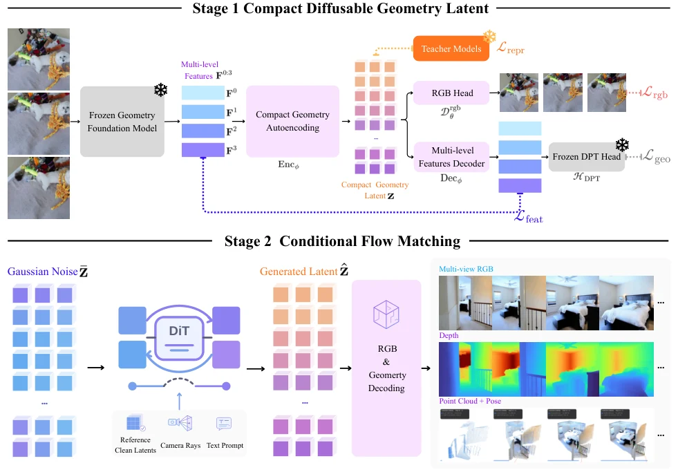

# GAE: Learning a Geometry-Native Latent Space for 3D-Consistent World Generation

- **作者**：Jiahao Lu, Minghao Yin, Wenbo Hu, Hengyu Liu, Wang Zhao, Sai-Kit Yeung, Ying Shan, Yuan Liu
- **年份与发表**：2026，arXiv 预印本（v1 首发 2026-09-21，v4 修订 2026-10-14）
- **arXiv ID**：2609.24981
- **首次提交**：2026-09-21
- **最近修订**：2026-10-14T09:21:07Z
- **arXiv 主分类**：cs.CV
- **核验日期**：2026-11-23
- **DOI**：[10.48550/arXiv.2609.24981](https://doi.org/10.48550/arXiv.2609.24981)
- **可靠入口**：[arXiv](https://arxiv.org/abs/2609.24981)｜[全文](https://arxiv.org/html/2609.24981v3)｜[项目](https://jiah-cloud.github.io/GAE.github.io/)｜[代码](https://github.com/TencentARC/GAE-GeometricAutoEncoder)｜[模型](https://huggingface.co/TencentARC/GAE-D64-1B)｜[AlphaXiv](https://alphaxiv.org/abs/2609.24981)
- **类别标签**：3D/4D, 世界模型, 视频生成, 扩散与流匹配
- **证据等级**：已核对 arXiv v3 正文、全部诊断/主实验/消融表及官方项目、代码与权重入口；未运行复现实验。
- **代表图**：GAE，Fig. 2，两阶段框架：先将冻结几何主干的多层特征压缩为外观—几何共享潜空间，再在标准化潜空间训练条件流模型。

来源：[Fig. 2 原图](https://arxiv.org/html/2609.24981v1/ngd_pipeline_overview.png)（v3 同图路径：[pipelne_gae.png](https://arxiv.org/html/2609.24981v3/pipelne_gae.png)）。

## 当前挑战

视频生成模型能画出逼真的画面，却常在视角移动时发生 3D 结构漂移和相机轨迹跑偏——“感知模型能读懂的 3D 世界，生成模型却写不出来”。作者把病根追溯到**潜空间表征本身**：

- **外观 VAE 与语义 RAE 缺几何**：像素 VAE（SD-VAE / Wan2.1）保外观，语义 RAE（RAEv2）组织语义，但深度、相机和跨视角关系都不是其原生可读状态；事后加深度头或几何损失治标不治本。
- **原生几何特征“不能直接拿来生成”**：以 DA3-Giant 为例，其几何头依赖 4 层特征金字塔（全建需要级联流模型，单选一层丢信息）；更致命的是原始特征高达 **3,072 通道**，有效秩却只有约 **11 维**、条件数高达 $10^8\text{–}10^{16}$，极度病态且各向异性，流匹配极难拟合。
- **“能重建”不等于“好生成”**：即便把多层几何特征压紧到能精准重建 RGB 和深度，若潜空间内部传输不平滑、空间邻域关系混乱，下游生成依然表现糟糕。

## 研究动机

**核心思路：别再往外观潜空间上“打几何补丁”，而是把几何基础模型的多层特征重参数化为一个紧凑、平滑、外观与几何原生共享的潜空间（GAE），让感知与生成共用同一接口。**

为了同时满足“保几何、融外观、好生成”，作者设计了三道环环相扣的约束：

- **夹在两个“冻结模块”之间学压缩**：在冻结 DA3 编码器与**冻结 DA3 几何头**之间插入轻量瓶颈，把 4 层特征压成 64/128 通道再一次性还原全金字塔——冻结几何头防止解码器“作弊”绕过丢失的几何信息；同时接一个可学习的 RGB 头，把外观也逼进同一个潜变量里。
- **先单点对齐语义，再成对拉回空间关系**：单靠 C-RADIO 逐 token 对齐虽能平滑流传输，却会把 token 间的空间结构打散；补上 DINOv2 成对相似度损失，把空间邻域关系直接锁在潜空间里。
- **消除参考帧的集合编码失配**：DA3 是集合条件编码器，训练时把参考图和目标图一起编码会与推理时“只看参考图”不匹配；改为仅用观测参考图编码干净条件 token，彻底消除训练/推理落差。

## 技术方案

**输入**：多视角 RGB 图像（阶段一经冻结 DA3 提取 4 层几何特征）；阶段二生成时接收文本提示、度量 Plücker 相机射线及可选参考图。

**过程**：阶段一训练几何原生自编码器，将归一化融合的 4 层 DA3 特征压缩为 64/128 通道潜变量，在冻结 DA3 几何头与可学习 RGB 头联合监督下重建全层级特征，并结合 C-RADIO 逐点对齐与 DINOv2 成对关系损失塑形潜空间；阶段二冻结编解码器，用标准 DiT 条件流匹配在标准化潜空间联合生成所有目标视角。

**输出**：同一组生成的紧凑潜变量原生解码为 3D 一致的 RGB 序列、深度图、相机射线与 3D 点图（支持图生视频、相机可控新视角与文生图）。

核心设计拆解（[方法：第 3 节](https://arxiv.org/html/2609.24981v3#S3)）：

- **四层融合 + 双头联合解码（24–48× 通道压缩）**：按训练集统计量逐层归一化 DA3 的 4 层特征并沿通道拼接，编解码器保持 patch 空间网格不变，仅把通道压到 64 或 128。解码端一边还原 4 层特征喂给**冻结的 DA3 DPT 头**读出深度/射线/点图，一边用独立 RGB 头直接渲染外观。
- **两级潜空间塑形（Table 1 机制验证）**：仅做重建时潜空间条件数虽从 $10^8$ 降至 130，但流传输平滑度 $\rho$ 仍弱；加入 C-RADIO 逐 token 对齐（$\mathcal{L}_{\text{tok}}$）后平滑度与语义邻域大涨，但空间结构指标 LDS/SRSS 从 0.240/0.300 暴跌至 **0.020/0.030**；再加入 DINOv2 成对相似度匹配（$\mathcal{L}_{\text{struct}}$）直接约束后验均值空间，LDS/SRSS 跃升至 **0.444/0.553**，同时保住传输平滑度。
- **干净参考条件 + 度量射线控制**：观测到的 $K$ 张参考图单独送入编码器得到干净条件 token（置 $t=0$）拼接在噪声目标槽位前参与联合注意力，所有目标槽位统一用标准 Euler 采样演进；配合度量 Plücker 射线与条件 Dropout，同一权重兼顾 T2I、相机控制与参考视角合成。

## 实验结果

受控实验固定完全相同的 DiT 流模型、度量相机条件与训练预算（RealEstate10K & DL3DV，9 视角 $252^2$），单独对比不同潜空间（Pixel VAE、Semantic RAEv2、Raw DA3 L0/L3 vs. GAE-64/128）：

| 评测维度 | GAE-64 表现 | 最佳非 GAE 受控基线 | 变化幅度 |
| --- | ---: | ---: | ---: |
| **RealEstate10K FVD ↓**（外观生成） | **225.7** | 258.6（SD-VAE） | **−12.7%** |
| **DL3DV FVD ↓**（外观生成） | **287.0** | 373.2（SD-VAE） | **−23.1%** |
| **RealEstate10K VGGT ATE ↓**（独立 3D 轨迹误差） | **0.0034** | 0.0072（SD-VAE） | **−52.8%（减半）** |
| **DL3DV VGGT ATE ↓**（独立 3D 轨迹误差） | **0.0056** | 0.0073（SD-VAE） | **−23.3%** |
| **生成几何解码（Table 7，Pi3 参考）** | DL3DV 全 6 项指标第 1 | Raw DA3 L0 / 外部 Gen3R、GLD | 深度与位姿全面领先 |

**Table 8 关键消融（RealEstate10K）揭示整套配方的真实贡献**：
- **潜空间塑形**（DA3-Giant-128）：无 $\mathcal{L}_{\text{repr}}$ FVD 266.4 → 仅 $\mathcal{L}_{\text{tok}}$ 241.9 → 加 $\mathcal{L}_{\text{struct}}$ **233.4**（且 ATE 同步降至 0.0041）；
- **干净参考条件 token**：相比把参考图放进 ODE 状态，FVD 从 257.1 降至 **225.7**，参考—目标点云断层误差缩小超 **3 倍**（0.1016 → 0.0318）；
- **度量位姿尺度 & T2I 联合训练贡献极大**：去掉度量尺度 FVD 恶化至 350.7；去掉 T2I 联合训练 FVD 恶化至 472.9。
- 另有放大版模型展示 81 帧（$672\times 378$）单次解码生成与文生图+深度，属定性能力展示，不参与上述受控对比。[实验：第 4 节](https://arxiv.org/html/2609.24981v3#S4)。

## 总结讨论

GAE 给出了一组非常扎实且具启发性的方法论结论：**3D 一致的世界生成本质上首先是“潜空间表征问题”，而非单纯的生成器架构问题**——把几何基础模型的病态多层特征重参数化为紧凑、低条件数、且兼顾语义与空间关系的共享潜空间，同一标准 DiT 就能同时把画质（FVD）和 3D 轨迹精度拉升一大截。

对具身智能与 4D 世界动作模型（WAM）而言，GAE 提供了一个很有吸引力的路线原型：**用几何原生潜空间作为未来世界演化的统一状态**，避免视频与几何双轨割裂。但需清醒看到其边界：当前验证全部集中在**静态场景相机漫游**，尚未涉及动态物体运动（4D）、动作条件干预或物理接触交互；若要迁移到具身 WAM，还需把静态几何底座升级为 π⁴/ARROW 类 4D 感知底座并引入动作条件转移。

## 代码与数据

官方项目页、GitHub 仓库（`TencentARC/GAE-GeometricAutoEncoder`）与 Hugging Face 权重（`TencentARC/GAE-D64-1B`）均已公开，包含 codec 与 flow 推理、训练及评估入口。GitHub API 显示许可证字段为 `NOASSERTION`；且官方明确说明公开的 `GAE-D64-1B` flow checkpoint 是在更高分辨率、更多帧和更多数据上继续训练的版本，**不能直接复现论文表 5–7 的受控实验数字**。

## 局限、失败案例与开放问题

- **局限于静态 3D 场景漫游**：评测集中于 RealEstate10K 和 DL3DV 的静态场景相机控制，尚未验证动态物体演化、动作干预或物理交互场景。
- **几何伪标签与评估器依赖**：Codec 几何监督采用冻结 DA3 输出作为伪目标，主评测几何真值也依赖 Pi3/VGGT 估计器与 $\mathrm{Sim}(3)$ 对齐，不等同于真实传感器级绝对度量精度。
- **生成质量高度依赖配套训练配方**：消融表明度量位姿尺度（+125 FVD 差距）和 T2I 联合训练（+247 FVD 差距）对最终生成效果影响极大，单独换潜空间并不自动保证同等表现。
- **受控评测分辨率与帧数有限**：定量受控对比仅在 $252^2$、9 视角下完成；81 帧高分辨率长推演与文生图目前仅为定性展示，缺少定量长程漂移指标。
- **公开权重与论文实验版本不一致**：复现论文受控指标需按论文配置重训，不可直接用公开的继续训练权重对标表 5–7。
