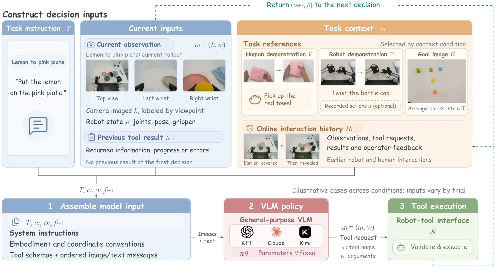

# 具身上下文学习与人类示教高效迁移：从示范对齐到跨本体 4D 桥梁

**更新日期**：2026-11-23

**报告标签**：具身上下文学习, 跨本体迁移, 第一视角与人类视频, 长时记忆, 适应与泛化

> 机器人如何只看几段甚至一段人类示教就学会新技能？这背后交织着两个不同层面的问题：**部署期如何利用上下文示范与回合记忆改变行为（ICL）**，以及**如何把廉价的人类操作视频跨过形态鸿沟迁移到异构机器人本体**。本专题把两条主线打通，按“部署时改变了什么”与“跨本体靠什么对齐”建立清晰坐标系。

本报告以现有馆藏为检索范围，严格区分方法事实、实验支持与综合判断；不同任务、输入权限、示范数与重试预算的成绩不直接横排。

[toc]

## 一、先分清两种问题：学一个新任务，还是记住正在做的任务

机器人忘记已放过几个零件，与机器人从未学过如何装配，是不同问题。前者需要**回合记忆**（保留对象身份、重复次数与停止条件），后者需要**上下文条件适配**（从外部示范中抽取任务语义与动作步骤）。把所有带历史输入的方法统称为 in-context learning，会掩盖两种机制及评价协议的根本差异。

## 二、部署期 ICL 机制分类：到底更新了什么对象

| 路线 | 部署时改变什么 | 代表工作 | 核心审查点 |
| --- | --- | --- | --- |
| 示范条件策略 | 输入中的视频或观测—动作示例 | [HOST](https://arxiv.org/abs/2607.20033)、[ContextFlow](https://arxiv.org/abs/2609.06852)、[Zero-WAM](https://arxiv.org/abs/2608.26103) | 是否真未见任务；示范与当前进度如何对齐 |
| 检索增强策略 | 从外部演示库取出的局部上下文 | [ICI-VLA](https://arxiv.org/abs/2609.07581)、[RA-VLA](https://arxiv.org/abs/2608.25585) | 检索库权限、动作标签与反直接复制机制 |
| 回合记忆与规划 | 历史 Token、摘要、子目标和进度 | [PonderPounce](https://arxiv.org/abs/2608.24115)、[2AM](https://arxiv.org/abs/2609.11308)、[Memory as Plans](https://arxiv.org/abs/2609.11561) | 对象身份、次数与停止条件是否准确 |
| 快速权重记忆 | 随历史递推更新的 fast weights | [RoboTTT](https://arxiv.org/abs/2607.15275) | 梯度成本、每回合重置与长期污染 |
| 显式少步微调 | 持久策略参数 | [GEN-1.5](https://generalistai.com/blog/gen-1.5)（few-step 设置） | 不能与其零梯度 physical prompt 成绩混用 |
| 冻结通用 VLM 编排 | 提示、工具结果与外部历史 | [GPT-Policy](https://arxiv.org/abs/2609.19138)、[RoboDawn](https://arxiv.org/abs/2609.22966) | 运动学工具、标定、调用与重试预算 |

[S1](https://skild.ai/blogs/s1) 的官方报告提供了大规模示范条件训练及长程案例，但公开架构与原始统计不完整，宜作为规模化参照与机制论文互补阅读。

## 三、部署期 ICL 的真正瓶颈：进度对齐与记忆压缩

**示范对齐重于堆长上下文**。[HOST](https://arxiv.org/abs/2607.20033) 先学习人机视频的单调进度再滑动示范窗口，把“示范做到哪一步”与“机器人下一步做什么”对齐；[ContextFlow](https://arxiv.org/abs/2609.06852) 压缩多视角示范为固定 Token 条件化动作流。检索路线中，[ICI-VLA](https://arxiv.org/abs/2609.07581) 用 DTW 对齐阶段并掩蔽目标动作防复制（去 DTW 后 RoboTwin 从 60.4% 跌至 31.4%）；[RA-VLA](https://arxiv.org/abs/2608.25585) 显式约束策略对相关与随机上下文产生差异响应；[ReWeight](https://arxiv.org/abs/2609.13851) 则把人类示范检索用于后训练加权，属离线数据利用而非部署期 ICL。

图 1：GPT-Policy 原文图。任务参考与在线执行历史分开管理，固定 VLM 调用结构化工具，控制器回传结果。[来源](https://arxiv.org/html/2609.19138#S3)。

**长上下文压缩决定什么记忆会丢**。[PonderPounce](https://arxiv.org/abs/2608.24115) 用慢速上下文引擎配合快动作模型（若仅阶段切换更新，RoboMME 从 60.83% 暴跌至 1.83%）；[RoboTTT](https://arxiv.org/abs/2607.15275) 把历史压进快速权重（8K 相对 1K 提升 62% 为相对增益）；[2AM](https://arxiv.org/abs/2609.11308) 压缩为带目标点指令，接口清晰但严格停止率低（LIBERO-Mem 宽松 63.00% vs 严格 11.83%）；[Zeva-Ego](https://arxiv.org/abs/2609.24411) 将人类视频中间训练（ACE）与部署期动作—效果历史（ICCL，四次尝试 58%→89%）分开评估。

## 四、人类示教高效迁移：从像素示范到跨本体 4D 交互不变量

直接把人类操作视频塞给机器人策略，最大的障碍是**人手与机械臂在外观、自由度、视角和运动学上的巨大形态鸿沟**。近期高质量工作探索出三类越来越抽象、迁移效率越来越高的跨本体桥梁：

| 跨本体桥梁 | 抽取什么不变量 | 代表工作 | 优势与核心边界 |
| --- | --- | --- | --- |
| **像素级“机器人化”换臂** | 从视频追出末端轨迹 → 抠除源臂/人臂 → IK 渲染目标机器人 | [HuRo](https://arxiv.org/abs/2609.10706)、[TCP4D](https://arxiv.org/abs/2611.23143) | 直接产出目标本体视觉—动作对（TCP4D 零源状态日志令 ARX-X5 联合训练 +41.5 pp）；受限于 IK 可达性与背景修复伪影 |
| **物体中心 4D 交互可供性** | 不追人体关节，直接预测“任务下交互相关 3D 点未来怎么动” | [A4A](https://arxiv.org/abs/2609.05892) | 天然弱化人手与夹爪形态差异，直指物体几何与作用方向；仍需底层控制器落实抓握姿态 |
| **接触引导跨形态重定向** | 把动作先验拆解为全局/部位潜码，以物体接触约束同步调整物体与动作 | [ReCHOIR](https://arxiv.org/abs/2609.10982) | 保留接触语义而非机械拷贝关节角；目前主要验证于多形态角色 HOI 重定向 |

**关键趋势**：单纯在 2D 像素空间做示范检索或换臂容易受背景和外观干扰，而把人类示教抽成**跨本体 4D 交互不变量**（物体接触点未来 3D 运动 + 工具中心点 $\mathrm{SE}(3)$ 轨迹），既能直接喂给部署期 ICL 做“看一次就会”，又能联动课题组内 HOI 4D 重建管线批量放大训练数据。

## 五、代表证据与可比较评估协议

| 工作与设置 | 报告结果 | 更有解释力的边界 |
| --- | --- | --- |
| HOST，50 个未见任务×20 次 | 平均 62% | 单一双臂平台；技能获取耗时不同于每步推理延迟 |
| ContextFlow，LIBERO 4 个未见任务 | 73.5%（ContextAR 53.5%） | 留出任务范围小，不等价于任意跨本体泛化 |
| ICI-VLA，4 个实机任务共 1000 次 | 83.2%（95% 区间 80.8–85.4） | 去 DTW 后 RoboTwin 60.4% → 31.4%，直接定位对齐价值 |
| RA-VLA，整套 LIBERO 留出，3 示范 | 38.45%（RICL-R 20.85%） | 全留出基准不可与已见任务高分直接横排 |
| MemCorr-DP，反事实参考诊断 | 正确参考 292/300 vs 错误参考 5/300 | 证明条件通道真被利用，但主测已知 Door 任务 |
| TCP4D 跨本体增广（4 任务） | ARX-X5 30.5% → 72.0%；源 Aloha 53.5% → 65.5% | 无需源机器人状态日志，同时反哺源本体与目标本体 |

**可比较的评估底线**：（1）先声明泛化轴（未见物体 / 布局 / 技能 / 组合 / 本体）；（2）固定示范数、人工反馈与重试预算；（3）必测**反事实示范诊断**（错误示范、同物不同任务、交换步骤），只有错误示范按预期改变输出，才证明策略真在读示范而非背分布。

## 六、参考文献与馆藏入口

1. [HOST: Robots Acquire Manipulation Skills in Seconds from a Single Human Video](https://arxiv.org/abs/2607.20033) · [馆藏卡片](../../index.html#paper=arxiv-2607-20033)
2. [ContextFlow: In-Context Flow Matching for Robot Manipulation](https://arxiv.org/abs/2609.06852) · [馆藏卡片](../../index.html#paper=arxiv-2609-06852)
3. [Zero-WAM: In-Context World-Action Modeling from Human Videos](https://arxiv.org/abs/2608.26103) · [馆藏卡片](../../index.html#paper=arxiv-2608-26103)
4. [ICI-VLA: In-Context Imitation with Spatiotemporally Aligned Demonstrations](https://arxiv.org/abs/2609.07581) · [馆藏卡片](../../index.html#paper=arxiv-2609-07581)
5. [RA-VLA: Retrieval-Augmented VLA for Test-Time Adaptation](https://arxiv.org/abs/2608.25585) · [馆藏卡片](../../index.html#paper=arxiv-2608-25585)
6. [PonderPounce: A Pretrained MLLM as an Episode Context Engine](https://arxiv.org/abs/2608.24115) · [馆藏卡片](../../index.html#paper=arxiv-2608-24115)
7. [2AM: Grounding Agent-Side Memory as Guidance for Steerable Action Models](https://arxiv.org/abs/2609.11308) · [馆藏卡片](../../index.html#paper=arxiv-2609-11308)
8. [Memory as Plans: World-Action Modeling with Memory-Grounded Planning](https://arxiv.org/abs/2609.11561) · [馆藏卡片](../../index.html#paper=arxiv-2609-11561)
9. [RoboTTT: Context Scaling for Robot Policies](https://arxiv.org/abs/2607.15275) · [馆藏卡片](../../index.html#paper=arxiv-2607-15275)
10. [GEN-1.5: Embodied Foundation Models are One-Shot Learners](https://generalistai.com/blog/gen-1.5) · [馆藏卡片](../../index.html#paper=paper-5299527392)
11. [GPT-Policy: In-Context Robot Learning with VLM Agents](https://arxiv.org/abs/2609.19138) · [馆藏卡片](../../index.html#paper=arxiv-2609-19138)
12. [RoboDawn: Transferring the Intelligence of VLMs to Robotic Control](https://arxiv.org/abs/2609.22966) · [馆藏卡片](../../index.html#paper=arxiv-2609-22966)
13. [Introducing S1: In-Context Learning for Robotics](https://skild.ai/blogs/s1) · [馆藏卡片](../../index.html#paper=paper-d14a137e07)
14. [ReWeight: Leveraging Human Data for VLA Post-Training](https://arxiv.org/abs/2609.13851) · [馆藏卡片](../../index.html#paper=arxiv-2609-13851)
15. [Zeva-Ego: Egocentric Mid-Training with In-Context Causal Learning](https://arxiv.org/abs/2609.24411) · [馆藏卡片](../../index.html#paper=arxiv-2609-24411)
16. [MemCorr-DP: Counterfactual Correspondence Conditioning](https://arxiv.org/abs/2609.06615) · [馆藏卡片](../../index.html#paper=arxiv-2609-06615)
17. [TCP4D: A Unified Tool-Center-Point Tracking and Generation Model](https://arxiv.org/abs/2611.23143) · [馆藏卡片](../../index.html#paper=arxiv-2611-23143)
18. [A4A: Cross-Embodiment Transfer of Action-Oriented 4D Affordances](https://arxiv.org/abs/2609.05892) · [馆藏卡片](../../index.html#paper=arxiv-2609-05892)
19. [HuRo: Robotizing Human Videos for Scalable VLA Pretraining](https://arxiv.org/abs/2609.10706) · [馆藏卡片](../../index.html#paper=arxiv-2609-10706)
20. [ReCHOIR: Contact-guided HOI Retargeting to Diverse Characters](https://arxiv.org/abs/2609.10982) · [馆藏卡片](../../index.html#paper=arxiv-2609-10982)
