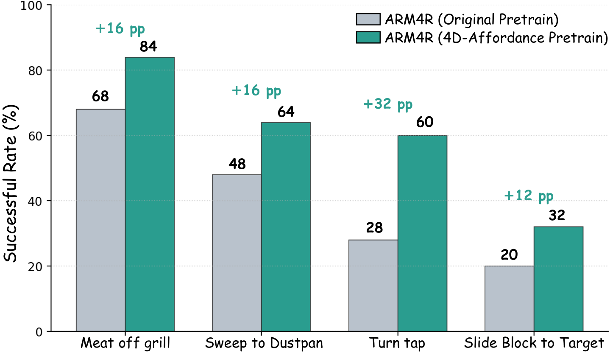

## 用途

同一个 `.qmd` 文件既出网页也出 PDF，正文只写一次。

## 公式

$$
\mathcal{L}(\theta) = \mathbb{E}_{x \sim p_{\text{data}}}\left[-\log p_\theta(x)\right]
$$

## 代码

```python
def success_rate(episodes):
    return sum(e.success for e in episodes) / len(episodes)
```

## 图表

{#fig-figure width=60%}

交叉引用写作 `@fig-figure`，渲染后自动编号为 @fig-figure。

## 表格

| 出口 | 命令 | 说明 |
|------|------|------|
| 网页 | `quarto render` | 静态 HTML，可直接挂站点 |
| PDF | `quarto render --to pdf` | LaTeX 排版 |
