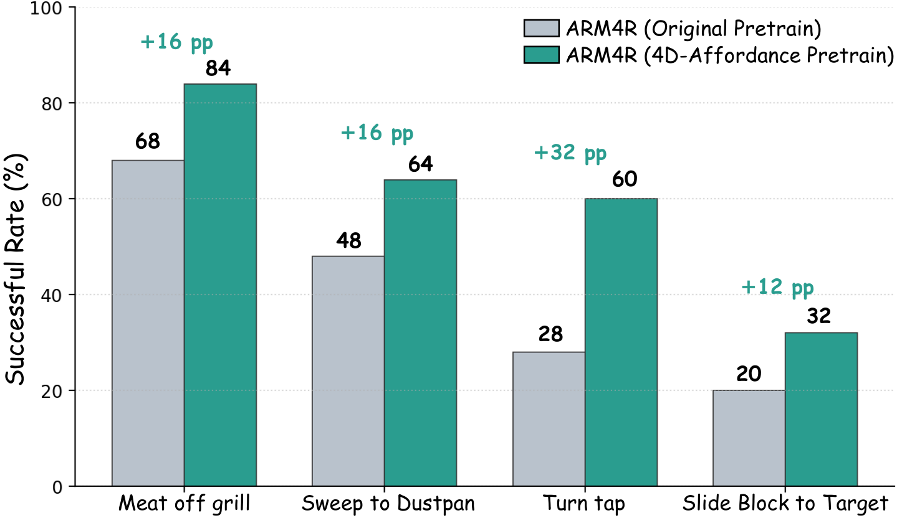

## 为什么用它

- 源是纯 Markdown，进 Git，能 diff
- 一条命令出网页、PDF、PPTX
- 公式、引用、交叉引用是内置的，不用手写 HTML

## 公式与代码

行内公式 $E = mc^2$，块级公式：

$$
\mathcal{L}(\theta) = \mathbb{E}_{x \sim p_{\text{data}}}\left[-\log p_\theta(x)\right]
$$

```python
def success_rate(episodes):
    return sum(e.success for e in episodes) / len(episodes)
```

## 图表

{width=60%}

## 表格

| 出口 | 命令 | 说明 |
|------|------|------|
| 网页 | `quarto render` | reveal.js，可直接挂静态站 |
| PDF | `quarto render --to pdf` | LaTeX 排版 |
| PPTX | `quarto render --to pptx` | 原生文本框，可编辑 |

## 下一步

改 `slides.qmd`，跑一次 `quarto render`。
